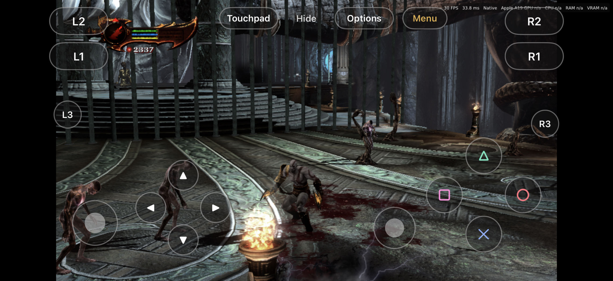
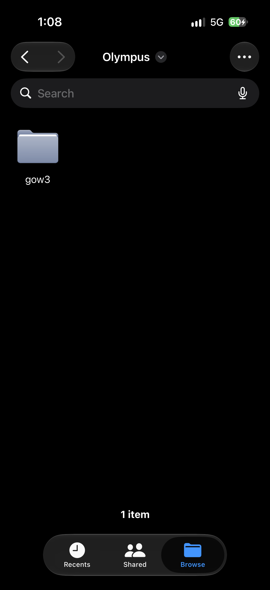
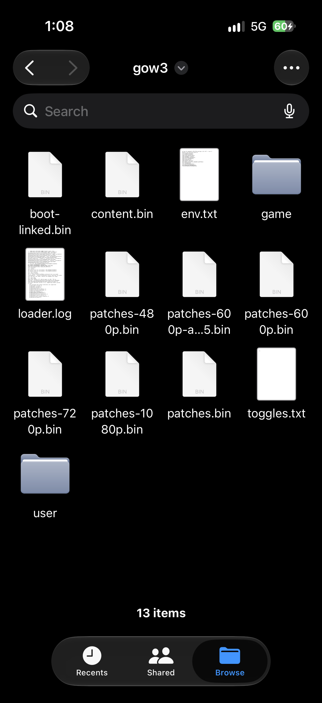

# God of War III on iPhone: Olympus (gow3-ios), a native iOS port of the PS4 game

**Olympus** (project name **gow3-ios**) brings **God of War III Remastered (PS4)** to the **iPhone**, without jailbreak, by
sideloading. It is a native port, not a PS4 emulator: the game's own `eboot.bin` runs inside the
app, its x86-64 code is translated to ARM64 by **FEXCore** (JIT), a game-specific runtime replaces
the PS4 system libraries, and **shadPS4's video core** renders through **Vulkan on Metal (MoltenVK)**.
It is the iOS counterpart of [gow3_android](https://github.com/wyatt-poole/gow3_android), which is
based on the PC port [gow3_pc](https://github.com/FelipePrado0/gow3_pc).

> **Status: playable, in development.** On an iPhone 17 the game runs from the title screen through
> gameplay and boss fights (Poseidon) with correct textures, sound, cutscenes, a controller or on-screen
> controls, and saves. It runs at a 30 FPS cap: steady in most places, with dips to about 24 in the
> heaviest fights. See [Project status](#project-status) and [Performance](#performance).
>
> **No game files are included, and none will be.** You need your own legal dump of the game.



**Gameplay recording (iPhone 17):** [docs/media/gameplay.mp4](docs/media/gameplay.mp4)

## Contents
- [Features](#features)
- [Project status](#project-status)
- [Performance](#performance)
- [Requirements](#requirements)
- [Install on iPhone (sideload)](#install-on-iphone-sideload)
- [Enable JIT](#enable-jit)
- [Add your game files](#add-your-game-files)
- [Playing](#playing)
- [FAQ](#faq)
- [Build from source (no Mac needed)](#build-from-source-no-mac-needed)
- [How it works](#how-it-works)
- [Credits and license](#credits-and-license)

## Features
- **Runs the original PS4 game code** on iOS through the FEXCore x86-64 JIT (no recompilation, no emulator).
- **Built-in JIT**: pair the iPhone with the app itself on iOS 27 (no computer, no StikDebug needed);
  StikDebug works too. See [docs/JIT.md](docs/JIT.md).
- **Vulkan on Metal** via MoltenVK, with shadPS4's GCN shader recompiler and Liverpool GPU emulation.
- **Sideloadable IPA built in the cloud** on GitHub Actions; no Mac required at any step.
- **Fits an 8 GB iPhone**: guest memory is file-backed, so it does not count against the app's memory limit.
- **The PC port's game patches and in-game settings/cheats menu**, from gow3_pc and gow3_android.
- **Controllers and touch**: DualSense/Xbox/MFi controllers, or on-screen controls with an editable
  layout (move and resize every button).
- **Console-style launcher**: one Play button that walks through game files, JIT and start; frame cap,
  touch controls and controller status at a glance; diagnostics and logs under System.

## Project status
| Area | State |
|---|---|
| JIT on iPhone (built-in pairing or StikDebug) | Works (iPhone 17, iOS 27) |
| FEXCore running the game's x86-64 code | Works; stable through long sessions since 0.1.45 (x18 fix) |
| PS4 runtime (kernel, memory, files, threads, saves) | Works |
| Graphics (shadPS4 video core on MoltenVK/Metal) | Works: menus, gameplay and bosses with correct textures (0.1.41+) |
| Audio and cutscene video | Work (CoreAudio through SDL3; FFmpeg) |
| Controllers and on-screen controls | Work, including the save list and the in-game menu |
| Performance | 30 FPS cap, mostly steady; heavy fights dip to about 24 (see below) |

Progress notes: [docs/NEXT.md](docs/NEXT.md). Platform findings: [docs/AUDIT.md](docs/AUDIT.md).

## Performance
Measured on an iPhone 17 with the 600p render patch (scaled to the screen):

| Scene | FPS |
|---|---|
| Menus | 60 |
| Most gameplay (30 cap) | 28-30 |
| Heaviest fights (2000+ draws per frame) | about 24-28 |

The 30 FPS cap is the default, as in the Android port; 60 and no cap are in the launcher. What
helped most: GPU readbacks as the PC port sets them, no FSR/object motion on iOS, MoltenVK without
Metal argument buffers, and FEX without x86 memory-order (TSO) emulation, as the Android port runs.
The remaining limit is GPU time per draw in heavy scenes; progress is tracked in [docs/NEXT.md](docs/NEXT.md).

## Requirements
- **iPhone with 8 GB RAM** (developed on the base **iPhone 17**), **iOS 26 or newer** (iOS 27 for
  in-app pairing).
- **AltStore** to install (SideStore drops the increased-memory-limit entitlement the game needs).
- **JIT**: the built-in helper with LocalDevVPN (App Store), or [StikDebug](https://github.com/StikDebug/StikDebug).
- **Your own dump of God of War III Remastered**: CUSA01623, CUSA01715 or CUSA01720, with update 01.02
  (about 35 GB free on the iPhone).
- For now, a PC (any OS with Python 3.10+) to make three small files from the dump with [tools/prepare](tools/prepare).

## Install on iPhone (sideload)
1. Download the IPA: Actions tab, **iOS IPA** workflow, latest successful run, artifact
   `gow3-ios-Release-ipa`.
2. Install it with **AltStore** (keep app extensions if asked). With a free Apple ID, refresh it every 7 days.
3. Turn on **Developer Mode** (Settings > Privacy & Security).

## Enable JIT
iOS only allows JIT for an app a debugger has attached to. gow3-ios brings its own:
1. Install **LocalDevVPN** and stay on Wi-Fi.
2. In the app, **Setup > Pair**, then Settings > Privacy & Security > Developer Mode >
   **Pair with gow3-ios**, and type the code shown.
3. Connect LocalDevVPN, tap **Check setup** once, then **Enable JIT** (the Play button also asks for
   JIT when it is needed).

Details and limits: [docs/JIT.md](docs/JIT.md).

## Add your game files
Everything goes into one folder: **Files > On My iPhone > Olympus > gow3** (the app's
`Documents/gow3`). Open the app once so the folder exists. It must look like this:

```
Olympus/
└── gow3/
    ├── boot-linked.bin      made on the PC by tools/prepare
    ├── content.bin          made by tools/prepare
    ├── patches.bin          made by tools/prepare
    └── game/                your dumped game folder, renamed to "game"
        ├── eboot.bin
        ├── sce_module/
        ├── sce_sys/
        │   ├── param.sfo
        │   └── icon0.png    (shown as the cover in the launcher)
        ├── EXEC/
        ├── ENGLISH/         (or your dump's language folders)
        └── *.plt
```

On the iPhone it looks like this (the gow3 folder also shows the app's own `user/` and `loader.log`;
the other extra files in this screenshot are test files and not needed):

<p>
   Olympus with the gow3 folder" width="260">
  
</p>

How to get there:
1. **Merge the 01.02 update** into the base game on the PC: copy the update's files over the base
   dump, replacing the old ones (its `eboot.bin`, `sce_sys/` and `.plt` files).
2. **Make the three `.bin` files** on the PC with [tools/prepare](tools/prepare) in this repo
   (Python 3.10+, standard library only; Windows, Linux or macOS), run on the *merged* dump:
   ```sh
   git clone --depth 1 https://github.com/MohinShaikh5689/god-of-war-3-ios gow3-ios   # or download the ZIP
   python3 gow3-ios/tools/prepare/make_gow3_folder.py /path/to/CUSA01623 --out gow3
   ```
   This writes `boot-linked.bin`, `content.bin` and `patches.bin` into `gow3/`. Add `--copy-game`
   to also copy the dump into `gow3/game`, and the finished `gow3/` folder can then be copied to the
   iPhone as it is. On Windows, use `python` instead of `python3`.

   <details><summary>Doing it by hand</summary>

   The tool runs gow3_android's scripts (copied in `tools/prepare/scripts`) in this order, as the PC
   port's `run.py` does:
   ```sh
   cd gow3-ios/tools/prepare
   GAME=/path/to/CUSA01623
   python3 scripts/prepare.py         "$GAME" --out out
   python3 scripts/link_libc.py       "$GAME" --out out
   python3 scripts/link_modules.py    "$GAME" --out out   # out/boot-linked.bin
   python3 scripts/content_profile.py "$GAME" --out out   # out/content.bin
   python3 scripts/patches.py --game-dir "$GAME" --out out   # out/patches.bin
   ```
   Then copy those three files from `out/` into `gow3/`. If you already play the PC or Android port,
   its `out/` folder has the same three files.
   </details>
3. **Copy the game**: rename the merged dump folder (for example `CUSA01623`) to `game` and copy it
   into `gow3/`. `eboot.bin` must be at `gow3/game/eboot.bin`: a `game/CUSA01623/eboot.bin` one level
   too deep is the most common mistake.

Redo step 2 whenever the dump's `eboot.bin` changes (another region or update). Making these files
on the phone itself is planned, so the PC step can go away.

The app creates the rest itself: `user/` (saves and `gow3.ini`, the in-game settings) and
`loader.log`. Don't delete `user/` when you replace the game files, or the saves go with it.
The game folder is about 30 GB; it is excluded from iCloud and computer backups, `user/` is not.

Copying: from Linux, `ifuse --documents <bundle id>` mounts the app's folder (libimobiledevice);
from Windows, iMazing works; on a Mac, Finder's file sharing. The launcher's **Setup > Game files**
panel shows which files are still missing. Then tap **Play**.

## Playing
- **Controls**: connect a controller in Settings > Bluetooth, or use the on-screen controls (they hide
  while a controller is connected; **Hide/Pad** at the top shows or hides them).
- **Edit the touch layout**: hold **Hide** until it reads **Done**, drag controls (face buttons and
  d-pad move as groups), tap one and use **-/+** to resize, **Reset** for the default, **Done** to save.
- **In-game settings and cheats**: the on-screen **Menu** button, or **R3 + L2** on a controller.
- **Back to the launcher**: two-finger double tap on an empty part of the screen (the game keeps running).
- **Frame cap**: 30 by default (launcher, Home > Frame cap), or 60 / off.
- Keep the app in the foreground while playing: iOS does not let a background app use the GPU.

## FAQ
**Can I play God of War 3 on iPhone with this?**
Yes, on an iPhone 17 (8 GB): it is playable through gameplay and boss fights at a 30 FPS cap. It is
still in development, so expect rough edges.

**Is this a PS4 emulator for iOS?**
No. It runs one game: the PS4 system libraries are replaced by a runtime written for God of War III,
and only the game's x86-64 instructions are translated (FEXCore). shadPS4's video core handles graphics.

**Do I need a jailbreak?**
No. It is a sideloaded app (AltStore). JIT comes from a debugger attach, done by the app's built-in
helper or StikDebug.

**Why is it not on the App Store?**
App Store apps cannot use JIT, and the game cannot run without it.

**Does it include the game?**
No, and it never will. Dump your own copy of the game you own.

**Which iPhones will work?**
Only the iPhone 17 (8 GB) has been tested. Other 8 GB iPhones with a recent Apple GPU (iPhone 15 Pro, 16 series) may work but are untested.
4-6 GB iPhones are not expected to fit the game.

**Is there an Android or PC version?**
Yes: [gow3_android](https://github.com/wyatt-poole/gow3_android) and [gow3_pc](https://github.com/FelipePrado0/gow3_pc).

## Build from source (no Mac needed)
Everything builds on GitHub Actions macOS runners:
- **iOS IPA** (`.github/workflows/ios.yml`): FEXCore, the runtime, the GPU library, MoltenVK and SDL3
  (`native/scripts/build-ios.sh`), then `expo prebuild` and an unsigned `xcodebuild`; the IPA is the
  `gow3-ios-Release-ipa` artifact. Run it from the Actions tab (workflow_dispatch) on any branch.
- **GPU library** (`.github/workflows/gpu.yml`): compiles shadPS4's video core for iOS and lists errors.
- **Runtime** (`.github/workflows/runtime.yml`): Linux tests and an iOS compile check.

The JavaScript app ships by EAS Update (`expo-updates`, channel `production`).

## How it works
```
Expo (React Native) app "Olympus": console-style launcher, JIT setup, game files, logs
└── native module (Swift) + libgow3core_all.a
    ├── gow3 runtime and loader (native/runtime/src)   PS4 kernel, memory, files, threads (HLE)
    ├── FEXCore (iOS fork) + JIT pool (native/cpu, native/jit)   x86-64 -> ARM64
    └── GPU library (native/runtime/gpu)   shadPS4 video core -> Vulkan -> MoltenVK -> Metal
```

| Path | What it is |
|---|---|
| `app/` | Expo shell; `app/modules/gow3-core` is the Swift native module (game view, touch controls). |
| `native/runtime/src` | gow3_android's runtime and loader, ported to Darwin. |
| `native/runtime/gpu` | gow3_android's GPU library (shadPS4 video core), ported to iOS/MoltenVK. |
| `native/cpu`, `native/jit` | `guest_cpu.h` on FEXCore for Darwin; the dual-mapped JIT pool. |
| `native/jit-helper`, `native/rppairing` | Built-in JIT helper extension and iOS 27 in-app pairing. |
| `native/third_party/FEX` | [willfaust/FEX](https://github.com/willfaust/FEX) `ios-port-2607`; local fixes in `native/patches/fex`. |

## Credits and license
gow3-ios is **GPL-3.0-or-later** (see `LICENSE`). It builds on:
- [gow3_android](https://github.com/wyatt-poole/gow3_android) and [gow3_pc](https://github.com/FelipePrado0/gow3_pc)
  (GPL-2.0-or-later): runtime, loader, GPU library and patches;
- [shadPS4](https://github.com/shadps4-emu/shadPS4) (GPL-2.0-or-later): video core and shader recompiler;
- [FEX](https://github.com/FEX-Emu/FEX) (MIT) and [willfaust/FEX](https://github.com/willfaust/FEX)'s iOS
  changes (GPL-3.0-or-later); [Madeira](https://github.com/willfaust/Madeira) for the iOS JIT approach;
- [MoltenVK](https://github.com/KhronosGroup/MoltenVK) (Apache-2.0), [SDL3](https://github.com/libsdl-org/SDL) (Zlib),
  StikJIT (MPL-2.0), idevice (MIT).

Not affiliated with Sony Interactive Entertainment or Santa Monica Studio. God of War is a trademark
of Sony Interactive Entertainment. This project contains no copyrighted game data.
